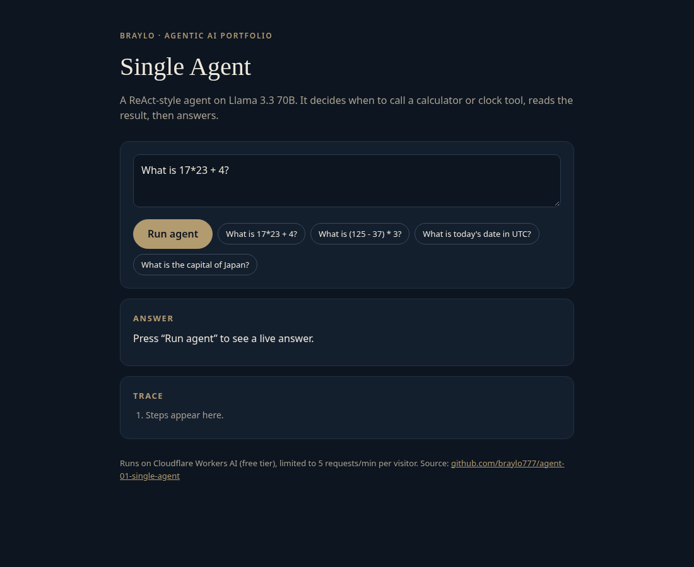
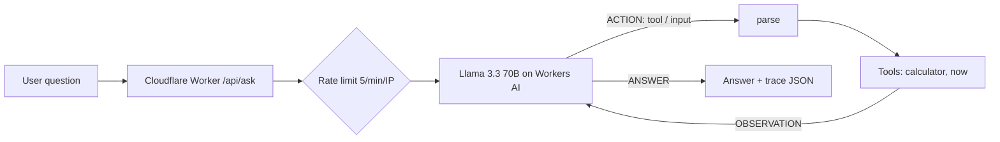

# Single Agent (ReAct)

A minimal ReAct-style agent: the LLM reasons, decides whether to call a tool (calculator or clock), reads the observation and answers. No framework, about 50 lines of agent logic. Runs serverless on Cloudflare Workers with the free Workers AI tier. Project 1 of a 10-part agentic AI portfolio by Braylo.

**Live demo:** https://agent-01-single-agent.braylo777.workers.dev



## Architecture


## How it works
1. The system prompt gives the model a strict protocol: `ACTION: <tool> | <input>` or `ANSWER: <text>`.
2. `parse()` reads the reply, including variants like `calculator(expr) | 2+2`.
3. Tools run in the Worker: `calculator` is a hand-written recursive-descent parser (no `eval`), `now` returns UTC time.
4. The observation is appended and the loop repeats, up to 4 steps. Unknown tools and tool errors go back to the model as observations instead of crashing.
5. The Worker returns the answer plus the full step trace.

- `src/agent.js`: protocol, parser, tools and loop (LLM injected so tests run offline)
- `src/index.js`: routes, rate limit, input cap
- `src/page.html`: demo UI

Guardrails: 5 requests/min per IP (Workers Rate Limiting), 500-character input cap, errors returned as JSON.

## Evaluation (live model)
[`evals/run.mjs`](evals/run.mjs) sends every case in [`evals/cases.json`](evals/cases.json) to the **deployed** demo (Llama 3.3 70B fp8 on Workers AI) and scores it. A case passes when the response is HTTP 200, the answer contains the expected key fact(s) (case-insensitive), and the set of tools used equals the expected set (empty for questions that need no tool). Latency is end-to-end HTTP from the eval machine. The suite is deliberately small to stay inside the free daily Workers AI allowance, so treat the numbers as indicative.

**Full run, 18 cases, before the eval-driven fixes** ([`evals/results.json`](evals/results.json), 2026-10-28T00:23:35.331Z):

| Metric | Value |
|---|---|
| Pass rate (answer correct and right tools) | 72.2% (13/18) |
| Answer accuracy | 72.2% (13/18) |
| Tool-selection accuracy (set of tools used = expected set) | 100.0% (18/18) |
| Latency p50 / p95 (end-to-end HTTP) | 1080 ms / 4647 ms |

**Re-run after the fixes, partial: 10 cases** ([`evals/results.postfix-partial.json`](evals/results.postfix-partial.json)): 10/10 passed; the same 10 cases passed 5/10 before the fixes. The re-run stopped early when the build machine was restored, and the shared free Workers AI daily allowance ran out before a full re-run, so the post-fix numbers cover only these cases. `node evals/run.mjs` reproduces the full suite.

Failures in the full (pre-fix) run:
- `m03` Compute 987654 / 6. → tools ['calculator', 'calculator', 'calculator', 'calculator']: Step limit reached.
- `m06` What is 123456 mod 97? → tools ['calculator', 'calculator', 'calculator', 'calculator']: Step limit reached.
- `m07` If I buy 7 items at $13.49 each, what is the total? → tools ['calculator', 'calculator', 'calculator', 'calculator']: Step limit reached.
- `m09` What is 3141 * 2718? → tools ['calculator', 'calculator', 'calculator', 'calculator']: Step limit reached.
- `m10` Subtract 4589 from 10000. → tools ['calculator', 'calculator', 'calculator', 'calculator']: Step limit reached.

**What the evals caught:** The first full run exposed a real bug: Llama often wrote `ACTION: calculator(expr) | 987654 / 6`, so the parser sent `(expr) | …` to the calculator, every call errored, and the agent hit its step limit (5 of 10 math cases). The parser now accepts that form, the prompt includes an example, and a regression test locks it in.

## Tests
15 offline unit tests (`node --test`), 15 passing. The LLM and HTTP APIs are mocked, so they run without a Cloudflare account.

## Run it
```bash
npm install
npm test                    # unit tests, Node 20+
npx wrangler dev            # local dev; Workers AI uses your Cloudflare login
npx wrangler deploy         # free tier, no paid API keys
node evals/run.mjs          # live eval against the demo (paced for the rate limit)
```

## License
MIT
